<picture>
  <source media="(prefers-color-scheme: dark)" srcset="assets/header-dark.svg">
  
</picture>

  <a href="https://salise.design"><b>salise.design</b></a>
  &nbsp;·&nbsp;
  <a href="https://x.com/salisestudio">@salisestudio</a>

 

I design and build products end to end: the interface, the interaction and the code that ships it.
I care about the details people feel but rarely notice — motion, type, spacing, speed.

 

## Now building

**[FocusKit](https://github.com/Darkyyto/studykit)** — a calm companion that lives in your Mac's notch.
Focus sessions, lecture notes that turn into flashcards, music and calendar at a glance. Native SwiftUI, fully on device.

 

## Toolkit

  

| Design | Apple platforms | Web |
| :-- | :-- | :-- |
| Interfaces, motion, branding | Swift, SwiftUI, AppKit | TypeScript, React, Next.js, Node.js |

 

Made with care in Italy · <a href="https://salise.design">salise.design</a>

