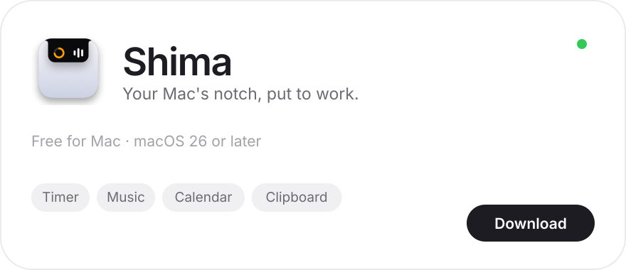
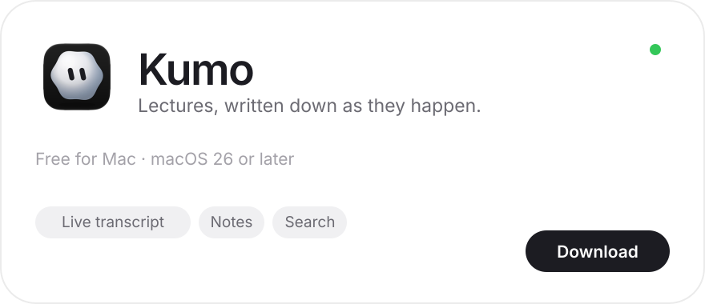

<picture>
  <source media="(prefers-color-scheme: dark)" srcset="assets/header-dark.svg">
  
</picture>

  <a href="https://salise.design"><b>salise.design</b></a>
  &nbsp;·&nbsp;
  <a href="https://x.com/salisestudio">@salisestudio</a>

  I design and build products end to end: the interface, the interaction and the code that ships it. 
  I care about the details people feel but rarely notice: motion, type, spacing, speed.

 

## Apps

Two small Mac apps. Native, fast, and nothing leaves your Mac.

<table>
  <tr>
    <td width="50%">
      <a href="https://github.com/Darkyyto/shima.app">
        <picture>
          <source media="(prefers-color-scheme: dark)" srcset="assets/shima-dark.svg">
          
        </picture>
      </a>
    </td>
    <td width="50%">
      <a href="https://github.com/Darkyyto/kumo.app">
        <picture>
          <source media="(prefers-color-scheme: dark)" srcset="assets/kumo-dark.svg">
          
        </picture>
      </a>
    </td>
  </tr>
</table>

 

## Toolkit

  

| Design | Apple platforms | Web |
| :-- | :-- | :-- |
| Interfaces, motion, branding | Swift, SwiftUI, AppKit | TypeScript, React, Next.js, Node.js |

 

Made with care in Italy · <a href="https://salise.design">salise.design</a>

